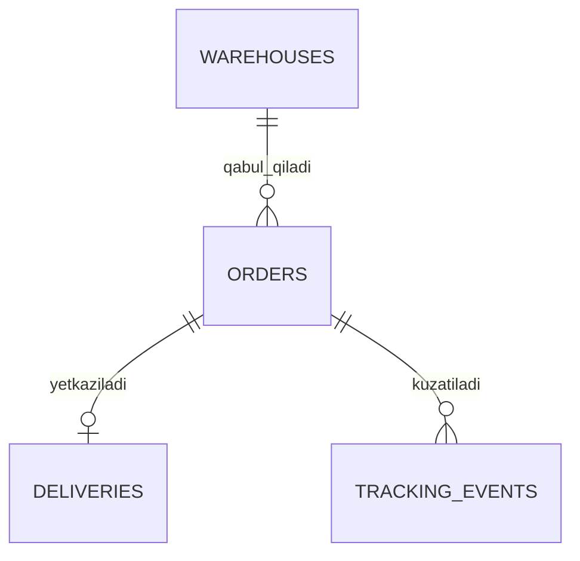

# Crystal Logistics

PDP University Unit 4 DevOps. Crystal jamoasi, 2-variant. Logistika va kuryer xizmati.

## Ishga tushirish

Python 3.9 yoki yangiroq versiya kerak. Repozitoriy papkasida demo buyurtmani yaratishdan topshirishgacha bajaradi.

```sh
python3 app.py demo
```

## Buyurtma bilan ishlash

Buyurtma yaratilganda javobda kuzatuv kodi chiqadi. Keyingi buyruqlarda `KOD` o‘rniga shu kodni yozing.

```sh
python3 app.py create "Demo manzil"
python3 app.py receive KOD
python3 app.py assign KOD "Demo kuryer"
python3 app.py dispatch KOD
python3 app.py deliver KOD
python3 app.py track KOD
```

Buyurtma holatlari `Yangi`, `Omborda`, `Yo‘lda`, `Yetkazildi`. `track` joriy holat va tarixni ko‘rsatadi. Oddiy buyruqlar ma’lumotni lokal `crystal.sqlite3` faylida saqlaydi.

## Ma’lumotlar modeli



## Docker demosini ishga tushirish

```sh
docker build --tag crystal-logistics .
docker run --rm crystal-logistics
```

GitHub Actions har bir `main` PR’ida testlarni ishlatadi, Docker obrazini yig‘adi va konteynerda demoni ishga tushiradi.

## Testlar

```sh
python3 -m unittest discover -s tests -v
```

[Jamoa kelishuvi](docs/team-charter.md) · [Kirish huquqlari](docs/access.md) · [Qarorlar](docs/decisions.md) · [Stand-up](docs/meetings.md)
