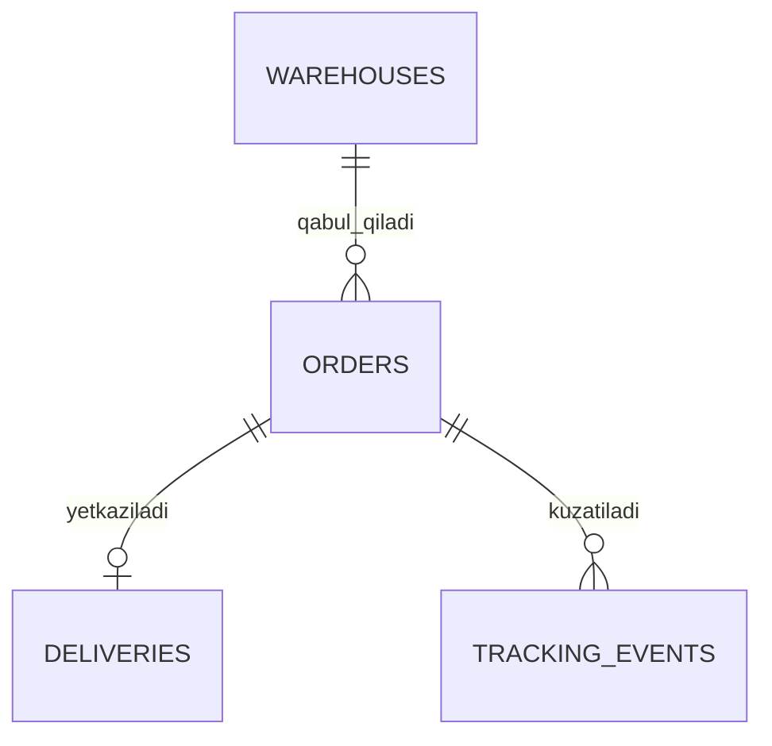

# Crystal Logistics

2-variant. Logistika va kuryer xizmati.

## Buyurtma qanday yetkaziladi?

1. Operator buyurtma ochadi va unga kuzatuv raqami beradi.
2. Ombor xodimi jo‘natmani qabul qilganini qayd etadi.
3. Operator buyurtmani kuryerga biriktiradi. Kuryer jo‘natmani olgach, holatini «Yo‘lda» deb belgilaydi.
4. Kuryer jo‘natmani topshirganda «Yetkazildi» holatini qayd etadi. Mijoz kuzatuv raqami orqali joriy holat va uning tarixini ko‘radi.

## Ma’lumotlar modeli loyihasi

| Obyekt | Vazifasi |
| --- | --- |
| `orders` | Buyurtma, yetkazish manzili va yagona kuzatuv raqami |
| `warehouses` | Jo‘natmani qabul qiladigan ombor |
| `deliveries` | Buyurtmaga biriktirilgan kuryer va yetkazish vaqti |
| `tracking_events` | Holat o‘zgargan vaqt va izoh |

Buyurtma holatlari `Yangi`, `Omborda`, `Yo‘lda` va `Yetkazildi`. Joriy holat kuzatuv tarixidagi oxirgi yozuvdan olinadi.

## Qabul qilish mezonlari loyihasi

- Har bir buyurtma uchun yagona kuzatuv raqami beriladi.
- Holat o‘zgarganida tarixga yangi yozuv qo‘shiladi.
- Buyurtma kuryerga biriktirilgach, yetkazish jarayonini boshlash mumkin.
- Kuzatuv sahifasi mavjud raqam uchun holat va tarixni ko‘rsatadi. Noma’lum raqam uchun buyurtma topilmaganini bildiradi.
