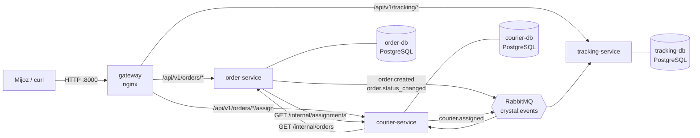
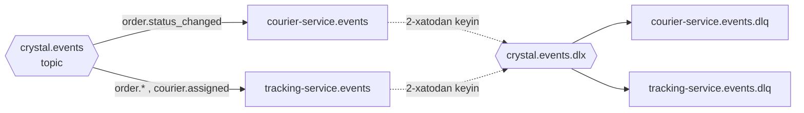
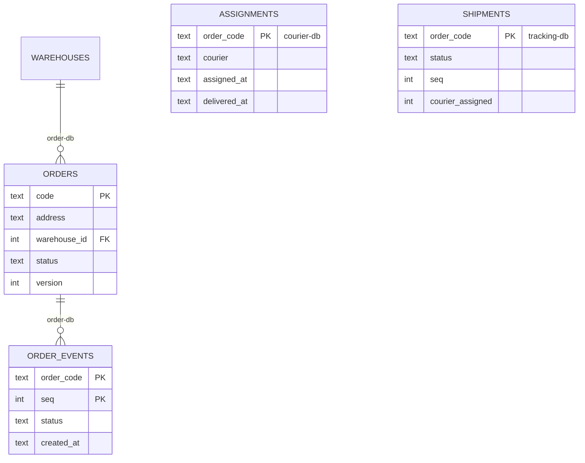
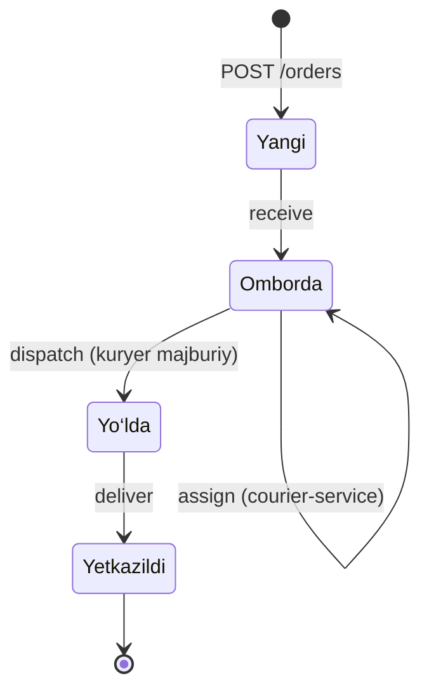

# Arxitektura

Crystal Logistics — uchta mustaqil mikroservis. Har bir servisning **o‘z bazasi**,
o‘z obrazi va o‘z yopiq tarmog‘i bor. Servislar bir-biri bilan faqat ikki yo‘l bilan
gaplashadi: **HTTP** (javob darhol kerak bo‘lsa) va **RabbitMQ hodisalari** (qolgan hamma narsa).

## Umumiy ko‘rinish



## Servislar

| Servis | Mas’uliyat | O‘z bazasidagi jadvallar | Chiqaradi | Tinglaydi | Sinxron chaqiradi |
| --- | --- | --- | --- | --- | --- |
| `order-service` | Omborlar, buyurtma, holat mashinasi | `warehouses`, `orders`, `order_events`, `outbox` | `order.created`, `order.status_changed` | — | courier-service (dispatch oldidan) |
| `courier-service` | Kuryer biriktirish, topshirilgan vaqt | `assignments`, `outbox`, `processed_events` | `courier.assigned` | `order.status_changed` | order-service (assign oldidan) |
| `tracking-service` | Ommaviy kuzatuv (read model) | `shipments`, `timeline`, `processed_events` | — | `order.*`, `courier.assigned` | hech kim |
| `gateway` | Yagona kirish, marshrutlash, rate limit, `X-Request-ID` | — | — | — | — |

Servis ichidagi qatlamlar avvalgidek: `api.py` (HTTP) → `service.py` (biznes qoida) →
`crystal_common.db` (SQL). Umumiy kod (`services/common/crystal_common`) biznes qoidalarini
bilmaydi — faqat infratuzilma: baza adapteri, HTTP karkas, shina, outbox/inbox, loglar.

## Database-per-service

- Uchta alohida PostgreSQL serveri (`order-db`, `courier-db`, `tracking-db`), har birida alohida
  foydalanuvchi, parol va volume.
- Har bir baza `internal` tarmoqda va unga **faqat o‘z servisi** ulangan. `courier-service`
  `order-db` nomini DNS’da ham topa olmaydi — buni `scripts/resilience_test.sh` CI’da tekshiradi.
- Servislar o‘rtasida `JOIN` yo‘q. Boshqa servisning ma’lumoti kerak bo‘lsa — uning API’si yoki
  hodisalari orqali olinadi. Shu sababli bitta servis sxemasini o‘zgartirish boshqalarni buzmaydi.
- `tracking-service` o‘ziga kerakli ma’lumotni hodisalardan o‘z bazasiga ko‘chirib oladi (CQRS
  read model). order-service ishlamay qolsa ham kuzatuv ishlayveradi.

## Hodisalar (RabbitMQ)



Hodisa formati (JSON):

```json
{
  "id": "6c1f…",                      // takrorni aniqlash uchun
  "type": "order.status_changed",      // routing key
  "source": "order-service",
  "occurred_at": "2026-11-22T10:00:00.123456+00:00",
  "payload": {"code": "CRY-…", "status": "Yo‘lda", "previous": "Omborda", "seq": 3}
}
```

| Hodisa | Payload | Kim tinglaydi |
| --- | --- | --- |
| `order.created` | `code`, `warehouse_id`, `status`, `seq` | tracking |
| `order.status_changed` | `code`, `status`, `previous`, `seq` | courier (faqat `Yetkazildi`), tracking |
| `courier.assigned` | `code`, `courier` | tracking (kuryer nomini saqlamaydi) |

### Kafolatlar

- **Transactional outbox.** Holat o‘zgarishi va hodisa bitta tranzaksiyada `outbox` jadvaliga
  yoziladi. Fon oqimi (`OutboxRelay`) ularni RabbitMQ’ga yuboradi (publisher confirms bilan).
  Broker o‘chib tursa ham buyurtma yaratiladi; hodisa broker qaytganda yetib boradi.
- **At-least-once + idempotent inbox.** Bir hodisa ikki marta kelishi mumkin. Qabul qiluvchi
  `processed_events`ga hodisa `id`sini yozadi; takror kelsa — e’tiborsiz qoldiriladi.
- **Tartib.** Hodisalar tartibsiz kelishi mumkin. `tracking-service` holatni faqat `seq` kattaroq
  bo‘lsa yangilaydi — eski hodisa yangi holatni bosib ketmaydi.
- **Dead letter queue.** Ikki marta xato bergan xabar `<servis>.events.dlq` navbatiga o‘tadi va
  RabbitMQ panelida (`http://localhost:15672`) qo‘lda tekshiriladi.
- Navbatlar `durable`, xabarlar `persistent` — broker qayta ishga tushsa ham yo‘qolmaydi.

## So‘rov oqimi: dispatch

```mermaid
sequenceDiagram
    participant C as Mijoz
    participant G as gateway
    participant O as order-service
    participant K as courier-service
    participant DB as order-db
    participant MQ as RabbitMQ
    participant T as tracking-service
    C->>G: POST /api/v1/orders/{code}/dispatch
    G->>O: X-Request-ID bilan
    O->>K: GET /internal/assignments/{code}
    K-->>O: 200 (kuryer bor)
    O->>DB: BEGIN; SELECT … FOR UPDATE
    O->>DB: UPDATE orders, INSERT order_events, INSERT outbox
    O->>DB: COMMIT
    O-->>C: 200 {"status": "Yo‘lda"}
    O--)MQ: OutboxRelay: order.status_changed
    MQ--)T: shipments.status = "Yo‘lda"
```

- Tarmoq so‘rovi tranzaksiyadan **oldin** qilinadi — baza qulfi boshqa servisni kutib turmaydi.
  Biriktirish o‘chirilmaydi, shuning uchun tekshiruv natijasi keyin ham haqiqiy qoladi.
- `SELECT … FOR UPDATE` bir buyurtmaga parallel ikki amalni ketma-ket bajaradi.
- courier-service ishlamasa dispatch `503` qaytaradi (boshqa amallar ishlayveradi). Ketma-ket
  5 xatodan keyin circuit breaker 10 s davomida so‘rov yubormaydi — order-service osilib qolmaydi.

## Ma’lumotlar modeli



Boshqa servis jadvallariga chet kalit (FK) yo‘q — ular boshqa bazada. Bog‘lanish faqat
`order_code` qiymati orqali.

## Holat mashinasi (order-service)



## Xatolar

| Holat | HTTP |
| --- | --- |
| Noto‘g‘ri ma’lumot | 400 |
| Topilmadi | 404 |
| Holatga mos emas | 409 |
| So‘rov 64 KB dan katta | 413 |
| Juda ko‘p so‘rov (gateway, 50 r/s) | 429 |
| Kutilmagan xato (tafsilot logda) | 500 |
| Bog‘liq servis ishlamayapti | 503 |

## Kuzatuvchanlik

- Barcha loglar JSON, bitta qatorda: `ts`, `level`, `service`, `msg`, `request_id`.
- Gateway har so‘rovga `X-Request-ID` beradi, servislar uni bir-biriga uzatadi va javobda qaytaradi.
  Bitta so‘rovning barcha servislardagi izi: `docker compose logs | grep <request_id>`.
- `/health/<servis>` — baza, broker, outbox relay holati. Baza ishlamasa `503`, faqat broker
  ishlamasa `200` + `"degraded"` (outbox tufayli servis ishlayveradi).

## Xavfsizlik

- Kuzatuv javoblari manzil va kuryer nomini qaytarmaydi.
- `/internal/*` endpointlar gateway’da yopiq — faqat servislar o‘rtasida.
- Barcha SQL parametrlangan. So‘rov tanasi 64 KB bilan cheklangan.
- Servis konteynerlari root emas (uid 10001), faqat o‘qiladigan fayl tizimi, `cap_drop: ALL`.
  Gateway — `nginx-unprivileged`. Har bir servis faqat o‘z bazasining parolini oladi.

## Cheklovlar va keyingi qadamlar

- Autentifikatsiya yo‘q. Keyingi qadam: gateway’da JWT tekshiruvi, rollar (operator, kuryer).
- Sxema ishga tushishda `CREATE TABLE IF NOT EXISTS` bilan yaratiladi. Sxema o‘zgarishlari
  ko‘paysa — har bir servis uchun alohida migratsiya vositasi (Alembic yoki Flyway).
- Metrikalar (Prometheus) va distributed tracing (OpenTelemetry) qo‘shilmagan.
- Production’da TLS gateway oldidagi reverse proxy yoki load balancer’da yoqiladi.
