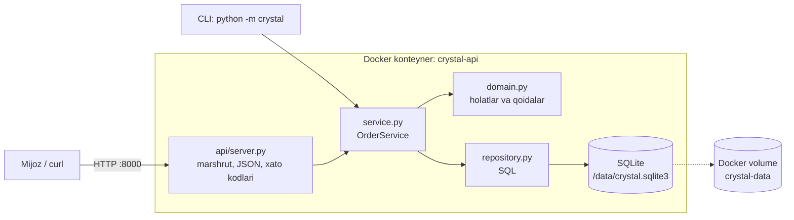
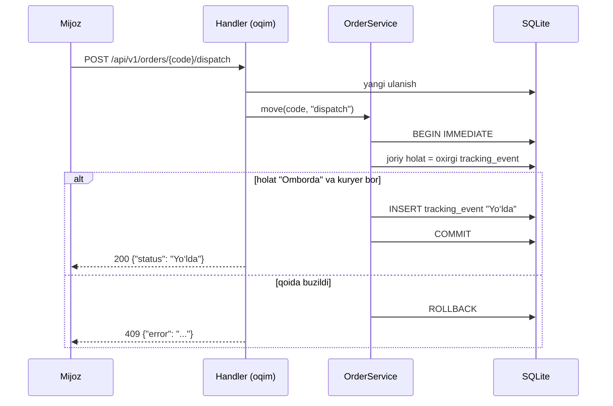
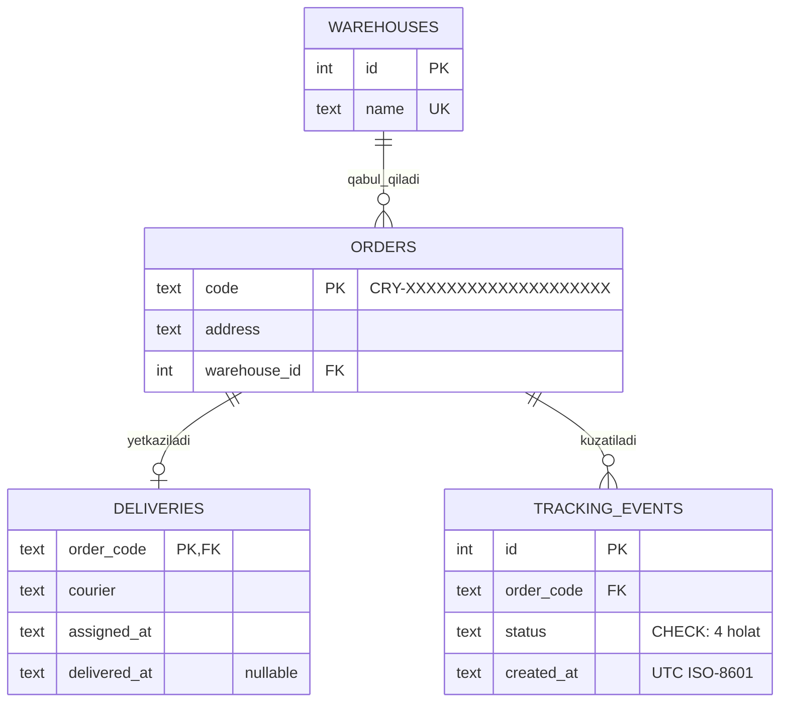
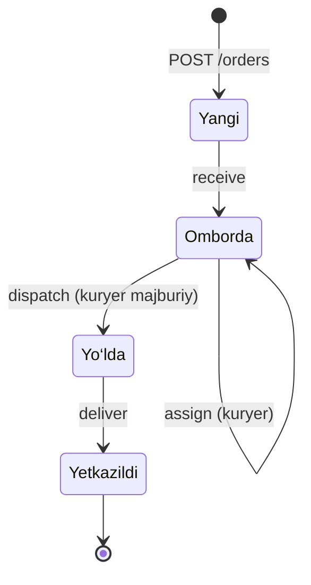

# Arxitektura

## Umumiy ko‘rinish

## Qatlamlar

| Qatlam | Fayl | Mas’uliyat | Nimaga bog‘liq |
| --- | --- | --- | --- |
| Kirish | `api/server.py`, `cli.py` | So‘rovni o‘qish, javobni formatlash, xatoni HTTP kodiga aylantirish | `service` |
| Biznes mantiq | `service.py` | Buyurtma hayot sikli, tranzaksiya chegaralari | `domain`, `repository`, `db` |
| Domen | `domain.py` | Holatlar, o‘tishlar jadvali, xato turlari | hech narsa |
| Ma’lumotlar | `repository.py`, `db.py` | SQL so‘rovlar, ulanish, sxema | `sqlite3` |
| Sozlama | `config.py` | `CRYSTAL_*` muhit o‘zgaruvchilari | `os.environ` |

Qoida: bog‘liqlik faqat pastga yo‘naladi. HTTP va CLI bir xil `OrderService`ni chaqiradi, shuning uchun biznes qoidasi bitta joyda yoziladi va ikkala interfeysda bir xil ishlaydi.

## So‘rov oqimi

- `ThreadingHTTPServer` har bir so‘rovni alohida oqimda bajaradi; har bir so‘rov o‘z SQLite ulanishini oladi (ulanishlar oqimlar orasida bo‘lishilmaydi).
- Yozish amallari `BEGIN IMMEDIATE` bilan boshlanadi: tekshirish va yozish o‘rtasida boshqa so‘rov holatni o‘zgartira olmaydi. Parallel so‘rovlar `busy_timeout` (5 s) davomida navbat kutadi.
- Fayldagi baza `WAL` rejimida ishlaydi — o‘qish yozishni to‘smaydi.
- Sxema faqat server ishga tushganda bir marta yaratiladi.

## Ma’lumotlar modeli

- Joriy holat alohida ustunda saqlanmaydi — u `tracking_events`dagi oxirgi yozuvdan olinadi. Tarix faqat qo‘shiladi, o‘zgartirilmaydi (append-only).
- `deliveries.order_code` birlamchi kalit — bitta buyurtmaga bitta kuryer.
- Kuzatuv kodi `CRY-` + 20 ta tasodifiy hex belgi (UUID4) — taxmin qilish qiyin.
- Ishga tushishda `Markaziy ombor` (id=1) avtomatik qo‘shiladi.

## Holat mashinasi

Ruxsat etilmagan har qanday o‘tish `ConflictError` → `409`.

## Xatolarni boshqarish

| Domen xatosi | HTTP | CLI chiqish kodi |
| --- | --- | --- |
| `ValidationError` | 400 | 2 |
| `NotFoundError` | 404 | 2 |
| `ConflictError` | 409 | 2 |
| kutilmagan xato | 500 (tafsilot logda, javobda emas) | 1 |

## Xavfsizlik va maxfiylik

- Kuzatuv javobi manzil va kuryer nomini qaytarmaydi — kod bilan faqat holat ko‘rinadi.
- Barcha SQL parametrlangan (`?`) — SQL injection yo‘q.
- So‘rov tanasi 64 KB bilan cheklangan; JSON bo‘lmagan tana `400`.
- Konteyner root bo‘lmagan `crystal` (uid 10001) foydalanuvchisi bilan, faqat o‘qiladigan fayl tizimida, barcha Linux capability’lari olib tashlangan holda ishlaydi ([deployment.md](deployment.md)).

## Cheklovlar va keyingi qadamlar

- Autentifikatsiya yo‘q — hozircha o‘quv prototipi. Keyingi qadam: API kalit yoki JWT, rollar (operator, kuryer).
- SQLite bitta konteyner uchun mos. Bir nechta replika kerak bo‘lsa PostgreSQL’ga o‘tish: `repository.py` yagona o‘zgaradigan qatlam.
- Reverse proxy (Nginx/Traefik) va TLS production muhitida qo‘shiladi.
